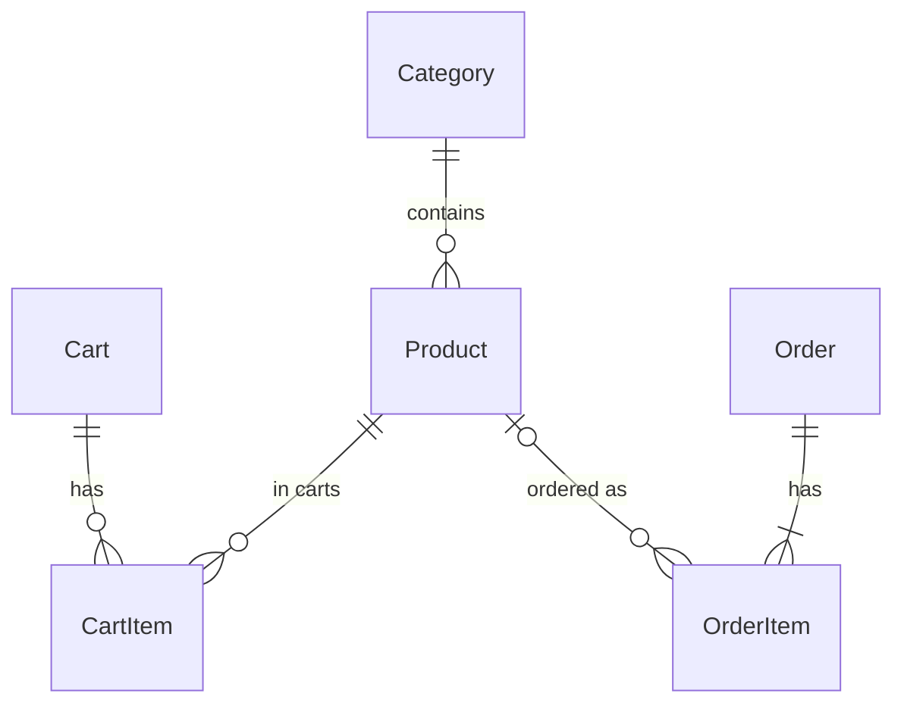

# Kindred Goods — demo online shop

A full-stack storefront with a **mock payment flow**. Shoppers can browse and search sample products, keep a
server-side cart, check out with a validated form, "pay" with a test card, and look up their orders by email.
No real payment provider is involved and no real card is ever charged.

| | |
| --- | --- |
| Frontend | React 19, TypeScript, React Router, Vite |
| Backend | Node.js, Express 5, TypeScript, Zod validation |
| Database | SQLite via Prisma (Turso hosted SQLite when deployed to Netlify) |
| Tests | Vitest + Supertest (API) and Testing Library (UI) |

## Quick start

Requires Node.js 20 or newer.

```bash
npm run setup   # installs dependencies, creates server/.env, builds the SQLite database and seeds it
npm run dev     # API on http://localhost:4000, storefront on http://localhost:5173
```

Open http://localhost:5173, add a few products to the cart and check out with the test card below.

Other useful commands:

| Command | What it does |
| --- | --- |
| `npm test` | Runs the API and UI test suites |
| `npm run typecheck` | Type-checks every workspace |
| `npm run preview` | Builds the React app and serves it together with the API on http://localhost:4000 |
| `npm run db:setup` | Applies migrations and re-seeds the sample catalog (clears carts and orders) |
| `npm run images` | Regenerates the product artwork in `client/public/images/products` |

## Mock payments

Checkout talks to a **mock payment gateway** (`server/src/services/paymentGateway.ts`) that behaves like a real
provider's test mode but never leaves the server.

| Card number | Result |
| --- | --- |
| `4242 4242 4242 4242` | ✅ Payment succeeds and the order is placed |
| `4000 0000 0000 0002` | ❌ Payment is declined ("Your card was declined") |
| Any other number | ❌ Rejected with "this demo store only accepts test cards" |

Use any expiry date in the future (for example `12/30`), any 3-digit CVC and any name. The checkout page has
one-click buttons that fill in either test card.

What happens when you press **Pay**:

1. The form is validated in the browser and again on the server with the same Zod schema
   (`shared/src/validation.ts`): required fields, email, phone, postal code, a Luhn-valid card number,
   a non-expired `MM/YY` date and a 3–4 digit CVC.
2. The server re-reads the cart, re-checks stock and recalculates the totals. Prices sent by the browser are never trusted.
3. The mock gateway authorizes the total. **If it declines, the request stops here: no order is saved, stock is
   untouched and the cart is kept** so the shopper can try another card.
4. If it approves, a single database transaction decrements stock (guarded so it can never go below zero),
   saves the order with its line items, and empties the cart. If that transaction fails, for example because
   another shopper bought the last unit a moment earlier, the authorization is voided and the shopper sees a
   clear message.

Only the card brand and last four digits are stored with an order. Full card numbers and CVCs are never saved
or logged. A short artificial delay (`MOCK_PAYMENT_DELAY_MS`, default 900 ms) makes the "Processing payment…"
state visible; tests set it to 0.

To connect a real provider later, replace `mockPaymentGateway.authorize` and `void` with calls to, for example,
Stripe Payment Intents. Nothing else in the checkout flow needs to change.

## Pricing rules

All money is stored and calculated in integer cents (`shared/src/pricing.ts`), shared by server and client.

- **Subtotal**: sum of unit price × quantity.
- **Tax**: 10% of the subtotal, rounded half-up to the nearest cent. Shipping is not taxed.
- **Shipping**: flat $7.99, **free when the subtotal is $75.00 or more**. Empty carts have no shipping.
- **Total**: subtotal + tax + shipping.

The cart shows how much more is needed for free shipping.

## Stock rules

- Adding to the cart checks that the quantity already in the cart plus the new units fits in current stock.
  Sold-out items cannot be added, and quantity changes in the cart are checked the same way.
- A cart line is flagged if stock drops below its quantity after it was added, and checkout is blocked until
  the shopper adjusts it.
- Stock is only reduced when an order is successfully paid. Each line is decremented with a conditional update
  (`stock >= quantity`), so two shoppers racing for the last unit can never oversell. There is a test for this.
- A single line is capped at 10 units per order.

## Data model



- **Category** / **Product**: the catalog. `stock` is the number of units available to sell.
- **Cart** / **CartItem**: one cart per browser session. The cart id is a random session id held in a signed,
  httpOnly cookie, so carts survive reloads without an account.
- **Order** / **OrderItem**: created only after a successful payment, so every stored order is paid. Product
  name, image and price are copied onto each order line so history stays accurate if the catalog changes.
  Orders store the contact details, shipping address, totals and the card brand and last four digits.

The schema lives in `server/prisma/schema.prisma` and migrations in `server/prisma/migrations`.

## Orders and privacy

- `/orders/:orderNumber` (the confirmation page) is visible to the browser session that placed the order, or to
  anyone who also supplies the email used at checkout. Order numbers alone don't expose customer details.
- `/orders` looks up order history by email, as the brief requires. A production store would put this behind a
  sign-in or a one-time link sent to that email.

## API

All endpoints are under `/api` and return JSON. Errors use `{ "error": { "code", "message", "fieldErrors?" } }`.

| Method | Path | Purpose |
| --- | --- | --- |
| GET | `/categories` | Categories with product counts |
| GET | `/products?search=&category=&sort=&inStock=` | Product listing. `sort` is `featured`, `price-asc`, `price-desc` or `name` |
| GET | `/products/:slug` | Product detail plus related products |
| GET | `/cart` | Current session's cart with totals |
| POST | `/cart/items` | Add `{ productId, quantity }` (stock checked) |
| PATCH | `/cart/items/:productId` | Set `{ quantity }` (0 removes the line) |
| DELETE | `/cart/items/:productId` | Remove a line |
| POST | `/checkout` | Validate, charge the mock gateway, and place the order |
| GET | `/orders?email=` | Order history for an email |
| GET | `/orders/:orderNumber` | One order (same session, or `?email=`) |

## Project structure

```
shared/   Pricing, validation and API types used by both server and client
server/   Express API, Prisma schema, migrations, seed data and tests
client/   React storefront (Vite)
netlify/  Netlify Function that wraps the Express API
scripts/  Setup and artwork generation helpers
```

## Deploying to Netlify

Netlify serves the built React app as static files and runs the Express API as a single Netlify Function
(`netlify/functions/api.ts`, configured in `netlify.toml`). Functions have no lasting disk, so a SQLite file
can't hold carts and orders there. Instead the same schema runs on **[Turso](https://turso.tech)**, a hosted
SQLite service with a free tier, through Prisma's libSQL driver adapter. Locally nothing changes: the app keeps
using the SQLite file.

1. **Create the database** (free Turso account):
   ```bash
   turso db create kindred-goods
   turso db show kindred-goods --url        # libsql://...
   turso db tokens create kindred-goods     # auth token
   ```
2. **Create tables and seed the catalog** from your machine:
   ```bash
   TURSO_DATABASE_URL="libsql://..." TURSO_AUTH_TOKEN="..." npm run turso:setup
   ```
3. **Create the Netlify site**: *Add new site → Import an existing project*, pick this repository and leave the
   base directory empty. Build command and publish directory come from `netlify.toml`.
4. **Set environment variables** in *Site configuration → Environment variables*:
   `TURSO_DATABASE_URL`, `TURSO_AUTH_TOKEN`, and `SESSION_SECRET` (any long random string).
5. Deploy. The storefront and `/api/*` are served from the same domain, so cookies work without CORS.

When `TURSO_DATABASE_URL` is set, the server and seed script use Turso; otherwise they use `DATABASE_URL`
(the local SQLite file). You can run the whole test suite against a libSQL database the same way.

## Configuration

`server/.env` (created from `server/.env.example` by `npm run setup`):

| Variable | Default | Purpose |
| --- | --- | --- |
| `DATABASE_URL` | `file:./dev.db` | Local SQLite file, relative to `server/prisma` |
| `PORT` | `4000` | API port |
| `SESSION_SECRET` | dev value | Signs the cart session cookie. Set a strong value in production |
| `MOCK_PAYMENT_DELAY_MS` | `900` | Simulated gateway latency |
| `TURSO_DATABASE_URL`, `TURSO_AUTH_TOKEN` | unset | Use Turso instead of the local file (Netlify) |

## Sample data

`npm run db:setup` seeds 24 fictional products across six categories (Audio, Workspace, Home, Kitchen, Apparel,
Outdoors). A few are deliberately low on stock and one (Drift True Wireless Earbuds) is sold out, so the stock
rules are easy to demo. Product artwork is generated from the catalog with icons from [Lucide](https://lucide.dev) (ISC).
